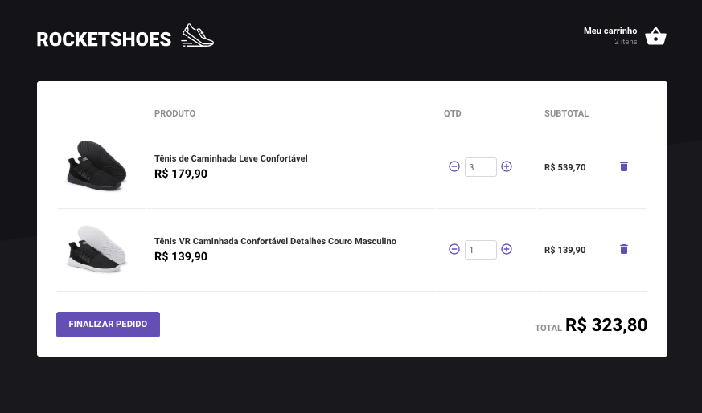

# 💻 React JS Application with Redux Saga

A modern web application built with **React JS** and **Redux Saga** for state management and asynchronous flow control.

This project demonstrates best practices for scalable frontend architecture using Redux, side-effect handling with Redux Saga, reusable components, API integration, and a clean UI structure.

---

## 📸 Preview




---

## 🚀 Technologies Used

This project was developed using the following technologies:

- React
- Redux
- Redux Saga
- React Hooks
- JSON Server
- Axios
- Styled Components
- Reactotron Redux/Saga
- React Router DOM
- Polished
- Immer

---

## ✨ Features

- State management with Redux
- Async operations with Redux Saga
- API consumption using Axios
- Local fake API using JSON Server
- Styled Components for scalable styling
- Route management with React Router DOM
- Improved debugging with Reactotron
- Immutable state updates using Immer

---

## ⚙️ Getting Started

### Prerequisites

Before running the project, make sure you have installed:

- Node.js
- Yarn or npm
- JSON Server

---

## 🔥 How to Run

### 1. Install dependencies

```bash
yarn
```

or

```bash
npm install
```

---

### 2. Start the React application

```bash
yarn start
```

or

```bash
npm start
```

---

### 3. Run the fake API server

```bash
json-server json-server.json -p 3333 -w
```

This will start the local API server on:

```text
http://localhost:3333
```

---

## 📌 Project Structure

This application follows a scalable frontend architecture using:

- Components
- Pages
- Store
- Sagas
- Services
- Routes
- Styles

This structure improves maintainability and makes future expansion easier.

---

## 🧠 Learning Goals

This project was created to practice and improve knowledge in:

- Global state management
- Side effects handling
- API integration
- Frontend architecture
- Clean code practices
- Performance optimization

---

## 📝 License

This project is for educational and portfolio purposes.

---
